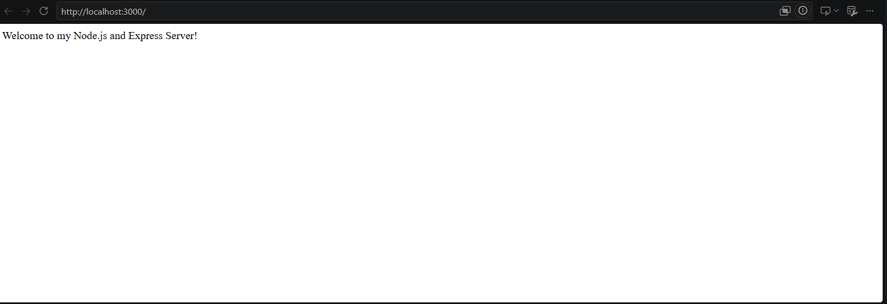
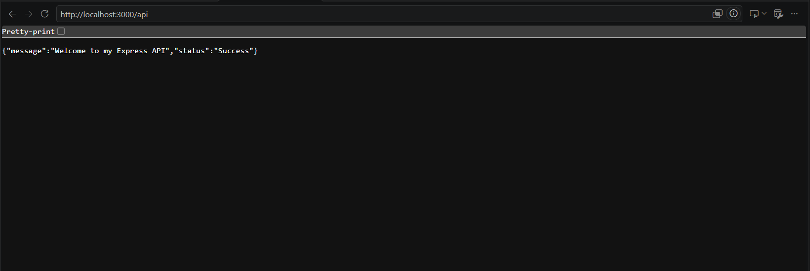
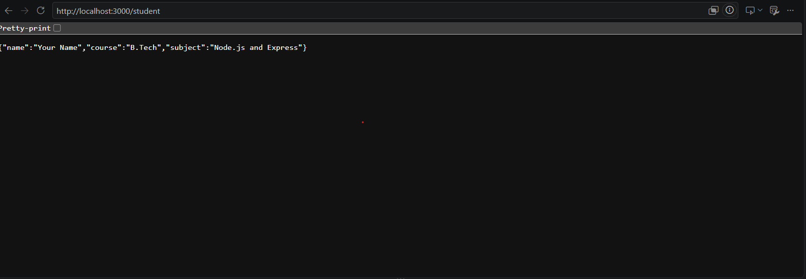
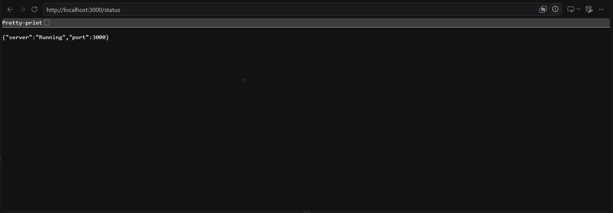

# Lab 1: Node.js and Express Server

**Deployment URL:**  https://bhuvanesh-damera.onrender.com

## Student Details

* **Name:** Bhuvanesh Damera
* **Registration Number:** 252U1R5035
* **Section:** AIDE-2A
* **Course:** B.Tech

## Project Description

This project demonstrates the creation of a basic web server using Node.js and Express.js. It includes multiple API endpoints that return responses to client requests.

## Technologies Used

* Node.js
* Express.js
* JavaScript
* Visual Studio Code

## Installation

1. Install Node.js.
2. Clone or download this repository.
3. Open the project folder in VS Code.
4. Install dependencies:

```bash
npm install
```

## Execution

Run the following command:

```bash
node server.js
```

The server will start at:

`http://localhost:3000`

## API Endpoints

| Method | Endpoint   | Description                 |
| ------ | ---------- | --------------------------- |
| GET    | `/`        | Displays welcome message    |
| GET    | `/api`     | Returns API information     |
| GET    | `/student` | Returns student information |
| GET    | `/status`  | Displays server status      |

## Screenshots

### 1. Homepage



### 2. API Information



### 3. Student Information



### 4. Server Status



## Notes

* Express.js is used to create the server.
* The server runs on port 3000.
* All endpoints can be tested using a web browser.
* The project uses JSON responses for API endpoints.
